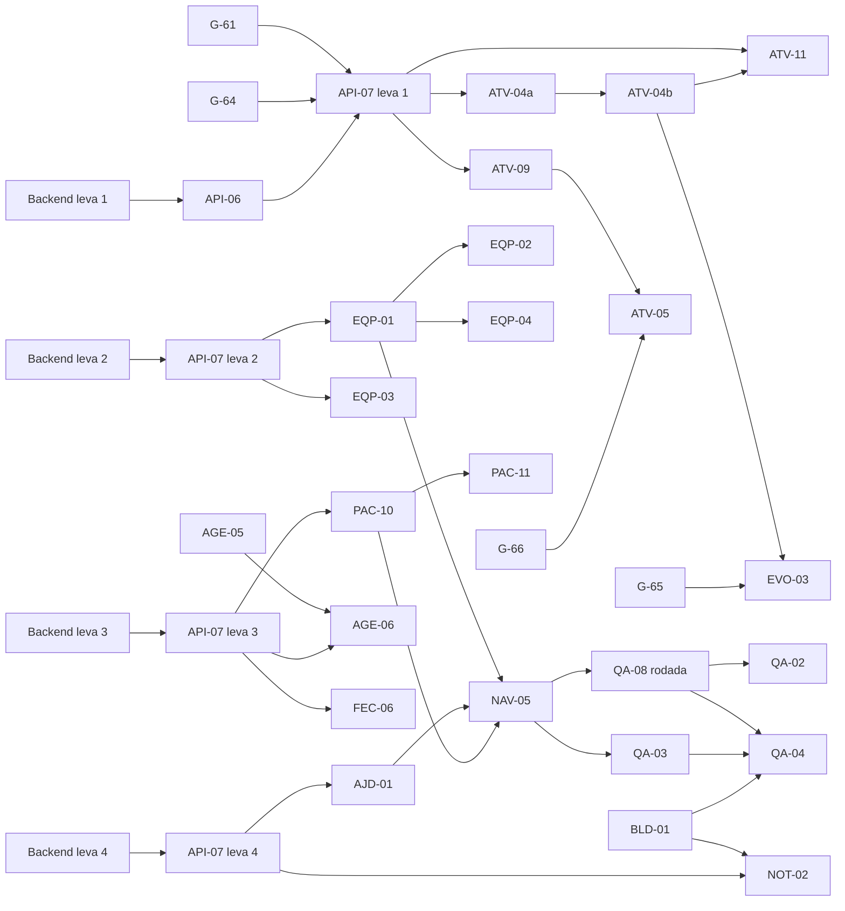

# Entrega 5 — Plano de execução

> Plano escrito em 2026-11-24 no refino dos cards, a partir da `main` (`3588b78`, PR #185), do
> [ROADMAP](ROADMAP.md), do [BACKLOG](BACKLOG.md) e do código. O detalhe de cada tarefa está em
> `cards/<ID>.md`: os blocos A e B neste PR ([API-06](cards/API-06.md), [API-07](cards/API-07.md),
> [FEC-06](cards/FEC-06.md), [ATV-09](cards/ATV-09.md), [ATV-04a](cards/ATV-04a.md),
> [ATV-04b](cards/ATV-04b.md), [ATV-11](cards/ATV-11.md), [ATV-05](cards/ATV-05.md),
> [EVO-03](cards/EVO-03.md)); os blocos C a F (`cards/EQP-*.md`, `PAC-*.md`, `AGE-*.md`,
> `BLD-01.md`, `NOT-02.md`, `AJD-01.md`, `NAV-05.md`, `QA-*.md`) num PR paralelo. O estado de cada
> tarefa continua no [TRACKING](TRACKING.md). **As decisões G-61 a G-72 são propostas**: este
> plano não dispara nada antes delas.

## 1. Resumo

- **25 tarefas** em 13 ondas (E5-0 a E5-12), com **cerca de 180 h de worker** (§5).
- O **backend é o caminho crítico**: quatro levas destravam os blocos B, C, D e E.
- O app **adianta com mocks** (G-29), mas só vai para a `main` o que não quebra o app contra o
  backend real de hoje (§4). O resto fica em PR de rascunho até a leva sair.
- No máximo **2 workers de código** ao mesmo tempo, com arquivos disjuntos.
- **Três rodadas de teste do Victor** no Expo Go, uma por leva integrada, e a rodada completa no
  emulador no fim (com autorização do usuário).

## 2. Ondas e sequência

| Onda  | Tarefas                           | Começa quando                                         | Pode ir para a `main` antes da leva? |
| ----- | --------------------------------- | ----------------------------------------------------- | ------------------------------------ |
| E5-0  | AGE-05, QA-08 (esqueleto), BLD-01 | G-61 (AGE-05 e QA-08); G-67 + autorização (BLD-01)    | Sim (não usam rota nova)             |
| E5-1  | API-07 leva 1                     | G-61, G-64                                            | Sim (tipos opcionais e mocks)        |
| E5-2  | ATV-04a, ATV-09                   | API-07 leva 1 na `main`                               | ATV-04a sim; ATV-09 **não**          |
| E5-3  | ATV-04b, ATV-11                   | ATV-04a na `main` (ATV-04b); API-07 (ATV-11)          | ATV-04b sim; ATV-11 **não**          |
| E5-4  | EVO-03, ATV-05                    | ATV-04b na `main` (EVO-03); ATV-09 na `main` (ATV-05) | EVO-03 sim; ATV-05 depois da ATV-09  |
| E5-5  | API-07 leva 2, EQP-01, EQP-03     | G-62, G-63                                            | API-07 sim; telas **não**            |
| E5-6  | EQP-02, EQP-04                    | EQP-01 na `main`                                      | **Não**                              |
| E5-7  | API-07 leva 3, PAC-10, AGE-06     | G-68, G-70; AGE-05 na `main`                          | API-07 sim; telas **não**            |
| E5-8  | PAC-11, FEC-06                    | PAC-10 na `main`; PP-05                               | **Não**                              |
| E5-9  | API-07 leva 4, NOT-02, AJD-01     | G-67, G-69; BLD-01 (NOT-02)                           | API-07 sim; telas **não**            |
| E5-10 | NAV-05                            | EQP-01, AJD-01, PAC-10 na `main`                      | —                                    |
| E5-11 | QA-08 (rodada), QA-03, QA-02      | Todo o código na `main`; autorização do emulador      | —                                    |
| E5-12 | QA-04                             | QA-08, QA-03, BLD-01                                  | —                                    |

A ordem real segue a chegada das levas: enquanto a leva 1 não sai, os workers fazem E5-0,
E5-1, ATV-04a, ATV-04b e EVO-03 (todos seguros na `main`) e deixam ATV-09 e ATV-11 em
rascunho. Se a leva 2 sair antes da 1, o bloco C passa na frente.

### 2.1 Caminho crítico

```
G-61/G-64 → API-07 (leva 1) → ATV-04a → ATV-04b → EVO-03 ─┐
backend leva 1 → API-06 → ATV-09 → ATV-05 ─────────────────┤
backend leva 2 → API-06 → EQP-01 → EQP-02 / EQP-04 ────────┤
backend leva 3 → API-06 → PAC-10 → PAC-11 ─────────────────┼→ NAV-05 → QA-08 → QA-02/QA-03 → QA-04
backend leva 4 → API-06 → AJD-01 ──────────────────────────┤
BLD-01 (autorização) ─────────────→ NOT-02 ────────────────┘
```

Sem backend, o app chega até EVO-03 e ATV-04b na `main` e ao resto em rascunho. O segundo
caminho crítico é a BLD-01: sem development build, não há push (NOT-02) nem Android físico com
push (QA-04).

### 2.2 Grafo de dependências



## 3. Paralelismo (máximo 2 workers de código)

Pares que podem rodar juntos (arquivos disjuntos conferidos nos cards):

| Par                | Por que não conflita                                                                                                                                         |
| ------------------ | ------------------------------------------------------------------------------------------------------------------------------------------------------------ |
| AGE-05 + API-07 L1 | Agenda × `src/api` e `src/mocks`                                                                                                                             |
| ATV-04a + ATV-09   | `engine/**` × resto de `src/features/activities/**`, detalhe da atividade e o atalho na ficha                                                                |
| ATV-04b + ATV-11   | `engine/{color-match,memory-game}` × `content-create/activity-types/**` e as rotas `app/content/*` (a ATV-11 só importa a paleta da ATV-04b depois do merge) |
| EVO-03 + ATV-05    | `sessions/player`, store, evolução e relatório da sessão × `activities/printable/**`, `navigation.ts`, detalhe                                               |
| EQP-01 + EQP-03    | `team/**` e Recursos × `(auth)/**`, login e `profile/join-team/**`                                                                                           |
| EQP-02 + EQP-04    | `team/**`, `permissions/**`, perfil e banner × ficha, lista de pacientes e `patients/shares/**`                                                              |
| PAC-10 + AGE-06    | `patients/**` × `agenda/**`                                                                                                                                  |
| PAC-11 + FEC-06    | ficha e lista × `patients/form`, `plans/detail`, `content-create/task`                                                                                       |
| NOT-02 + AJD-01    | conflitam em `package.json`, `pnpm-lock.yaml` e `app.json`: **em série** (NOT-02 primeiro, como no BACKLOG §3)                                               |

Docs (QA-08 esqueleto, API-06) não contam no limite de 2, mas não rodam junto com instalação ou
build.

## 4. Mock-first e política de merge

O padrão da Entrega 4 (mocks fiéis, teste pelo `apiClient` real, integração na leva) continua.
O que muda: desde a G-51 os mocks ficam **desligados por padrão**, então uma tela que chama rota
inexistente quebra o app de quem testa contra o backend real.

- **Vai para a `main` antes da leva** (seguro): AGE-05, QA-08 (esqueleto), BLD-01, as quatro
  API-07 (tipos opcionais, funções e mocks), ATV-04a, ATV-04b (só aparecem com tarefas desses
  tipos), EVO-03 (o envio só acontece com um jogo na sessão), ATV-05 (só aparece com
  imprimíveis; depende da ATV-09 na `main`).
- **Fica em PR de rascunho até a leva** e só entra depois do teste contra o backend real: ATV-09,
  ATV-11, EQP-01 a EQP-04, PAC-10, PAC-11, AGE-06, FEC-06, NOT-02, AJD-01.
- O worker do rascunho atualiza a branch com a `main` quando a leva sair e entrega com a
  evidência do backend real (AC `MAN` da tela).
- **Proposta para o usuário (pergunta 2, §10):** manter esta política ou mergear as telas atrás
  de uma flag de ambiente por domínio.

## 5. Estimativas por onda

Horas de worker (sem tempo de CI e revisão). Os cards dos blocos C a F podem refinar os números;
o card prevalece.

| Onda      | Tarefas (h)                                 | Total   |
| --------- | ------------------------------------------- | ------- |
| E5-0      | AGE-05 (5), QA-08 esqueleto (3), BLD-01 (4) | 12      |
| E5-1      | API-07 L1 (6)                               | 6       |
| E5-2      | ATV-04a (6), ATV-09 (10)                    | 16      |
| E5-3      | ATV-04b (6), ATV-11 (10)                    | 16      |
| E5-4      | EVO-03 (9 + 1 de revisão A), ATV-05 (5)     | 15      |
| E5-5      | API-07 L2 (5), EQP-01 (6), EQP-03 (8)       | 19      |
| E5-6      | EQP-02 (6), EQP-04 (8)                      | 14      |
| E5-7      | API-07 L3 (5), PAC-10 (6), AGE-06 (8)       | 19      |
| E5-8      | PAC-11 (5), FEC-06 (5)                      | 10      |
| E5-9      | API-07 L4 (4), NOT-02 (8), AJD-01 (5)       | 17      |
| E5-10     | NAV-05 (2)                                  | 2       |
| E5-11     | QA-08 rodada (8), QA-03 (6), QA-02 (8)      | 22      |
| E5-12     | QA-04 (6)                                   | 6       |
| Levas     | API-06 (4 × 1,5)                            | 6       |
| **Total** |                                             | **180** |

Com 2 workers, o código (E5-0 a E5-10) cabe em cerca de 85 h de relógio de worker, se as levas
não atrasarem.

## 6. Marcos e rodadas de teste

| Marco | Condição                                             | O que acontece                                                                                                                                |
| ----- | ---------------------------------------------------- | --------------------------------------------------------------------------------------------------------------------------------------------- |
| M0    | Usuário decide G-61 a G-72 e envia a especificação   | Dispara E5-0 e E5-1                                                                                                                           |
| M1    | E5-0, API-07 L1, ATV-04a, ATV-04b e EVO-03 na `main` | Base pronta para a leva 1                                                                                                                     |
| M2    | Leva 1 integrada (ATV-09, ATV-11, ATV-05 na `main`)  | **Rodada 1 do Victor** (Expo Go, backend real): banco, os três jogos, editor, imprimível e sessão → jogo → evolução, pelos roteiros dos cards |
| M3    | Leva 2 integrada (EQP-01 a EQP-04)                   | **Rodada 2 do Victor**, com **duas contas de teste**: criar equipe, convite, cadastro pelo convite, compartilhar e "por {autor}"              |
| M4    | Leva 3 integrada (PAC-10, PAC-11, AGE-06, FEC-06)    | **Rodada 3 do Victor**: status e pendências, arquivar/reativar, série semanal, limpar campos                                                  |
| M5    | Leva 4 integrada (NOT-02, AJD-01) e NAV-05           | Push no development build (aparelho com o APK); ajuda; nenhum "Em breve"                                                                      |
| M6    | Todo o código na `main`                              | **Emulador com autorização do usuário**: QA-08 (rodada completa), QA-03, QA-02                                                                |
| M7    | QA-04                                                | Android físico (dev build) e iOS se houver Mac ou iPhone; documento de entrega                                                                |

Cada rodada do Victor usa os roteiros "Como testar manualmente" dos cards e é registrada numa
issue de testes da Entrega 5 (como a #168 na Entrega 4; ver pergunta 3 do §10). O emulador só é
aberto pelo orquestrador com autorização do usuário no momento.

## 7. Gate → cards bloqueados

| Gate | Tema                                 | Cards bloqueados                    | Se a decisão for a alternativa                                    |
| ---- | ------------------------------------ | ----------------------------------- | ----------------------------------------------------------------- |
| G-61 | Escopo da entrega                    | Todos                               | Blocos C e E vão para a Entrega 6; o plano encurta                |
| G-62 | Modelo da equipe                     | EQP-01, EQP-02, EQP-03, EQP-04      | `ADMIN` vê todos os pacientes: muda a EQP-04 e a regra do backend |
| G-63 | Convite por código                   | EQP-01, EQP-03                      | Convite por e-mail: a EQP-03 vira link de cadastro                |
| G-64 | Jogos da entrega                     | API-07 L1, ATV-04a, ATV-04b, ATV-11 | Só "Forme a palavra": cancela a ATV-04b e reduz a ATV-11          |
| G-65 | Resultado do jogo                    | EVO-03                              | Jogo no acerto: só o backend muda; o app mostra                   |
| G-66 | PDF do imprimível no app             | ATV-05                              | PDF pronto do backend: a ATV-05 vira baixar e compartilhar        |
| G-67 | Push com development build           | BLD-01, NOT-02, QA-04               | Sem push: cancela BLD-01 e NOT-02; QA-04 só com Expo Go           |
| G-68 | Recorrência                          | AGE-06                              | Regra calculada na leitura: muda o contrato da série              |
| G-69 | Ajuda com `expo-video`               | AJD-01                              | Só texto: tira a dependência nova                                 |
| G-70 | Ativo/arquivado e status do servidor | PAC-10, PAC-11                      | Status calculado no app: PAC-10 cresce e perde a leva 3           |
| G-71 | RP-02                                | Nenhum (backend, PP-06)             | —                                                                 |
| G-72 | Repetição das notificações           | Nenhum (backend, PP-07)             | —                                                                 |

## 8. Riscos da entrega e mitigação

Os do [ROADMAP §7](ROADMAP.md#7-riscos) continuam. O refino acrescenta:

| Risco                                                          | Efeito                                      | Mitigação                                                                              |
| -------------------------------------------------------------- | ------------------------------------------- | -------------------------------------------------------------------------------------- |
| Mudar o player da sessão (EVO-03) quebra o quiz                | Sessões sem registro de resposta            | Quiz extraído sem mudar JSX e textos; testes atuais sem asserção alterada; revisão A   |
| Tela mergeada antes da leva quebra o app contra o backend real | Victor e usuário veem erro em telas antigas | Política do §4 (rascunho até a leva)                                                   |
| `null` não cabe em multipart (`PUT /student/update/:id`)       | FEC-06 incompleta                           | Pergunta ao backend na API-06; o paciente sai do PR se não houver resposta             |
| Erros de validação com `field` só no primeiro nível            | Campo errado não fica marcado no editor     | Fallback no topo do formulário (ATV-11 §6.5)                                           |
| Imagens remotas no PDF do `expo-print`                         | Imprimível sem figuras                      | Plano B com `data:` base64 (ATV-05 §11), sem dependência nova                          |
| PRs de rascunho longos ficam desatualizados                    | Conflitos na integração                     | Arquivos disjuntos por onda; atualizar a branch logo que a leva sair                   |
| Biblioteca pronta (seed) sem dono de conteúdo                  | "Atividades prontas" vazia                  | Estado vazio tratado; o editor (ATV-11) permite criar; pergunta 8 da especificação §12 |

## 9. Definition of Done

**De um card**

1. Todos os AC `UT`/`CT` do card com teste passando; `REV` conferido pelo revisor.
2. `pnpm run typecheck`, `pnpm run lint`, `npx prettier --check <arquivos>` e
   `python scripts/check-docs.py` com código 0 no worker; CI verde no PR.
3. Só arquivos permitidos no diff; nada de dependência fora das autorizadas (BACKLOG §1).
4. Mocks fiéis e teste pelo `apiClient` real para toda rota nova; seção no `src/mocks/README.md`.
5. Integrado ao contrato registrado (API-06) e testado contra o backend real (AC `MAN` ou roteiro
   do card) antes de "concluída" no TRACKING.
6. Nenhum dado real de paciente, senha, token ou conteúdo clínico em log, toast, commit ou PR.
7. PR com resumo, comandos e códigos de saída, limitações e desvios do card; TRACKING atualizado.

**Da entrega**

1. As 25 tarefas concluídas ou canceladas com motivo registrado no TRACKING.
2. QA-08 com todos os casos P1 aprovados no Android (emulador, backend real); QA-03 sem bloqueio;
   QA-02 com os fluxos passando; QA-04 com a matriz registrada (iOS só com evidência).
3. Nenhum "Em breve" no app (NAV-05).
4. `ENTREGA-5.md` com o que entrou, o que ficou fora e os pontos em aberto do backend.

## 10. Perguntas para o usuário

1. **G-61 a G-72** (ROADMAP §5): continuam bloqueando o início. Para o bloco B, as que importam
   primeiro são G-61, G-64, G-65 e G-66.
2. **Política de merge** (§4): rascunho até a leva (recomendado) ou flag por domínio?
3. **Issue de testes do Victor** para a Entrega 5 (como a #168): criar uma nova?
4. **Regra de `correct`** dos jogos: o refino propõe "completou sem erro" (ATV-04a §6.6).
5. **Conteúdo da biblioteca** (seed): quem produz as atividades prontas e os tutoriais?

## 11. Ajustes do refino

Diferenças entre o BACKLOG (e a especificação) e o código real, já refletidas nos cards. O
BACKLOG não foi reescrito; vale o card.

1. **O player da sessão não usa o motor de atividades.** `SessionPlayerScreen` desenha o quiz
   sozinho; o `ActivityEngine` só roda fora da sessão. A EVO-03 acrescenta um ramo de jogo ao
   player (quiz extraído sem mudança), cresce para G (9 h) e ganha revisão A.
2. **O contrato do motor é do quiz.** `ActivityAttempt` tem `alternativeId`; a ATV-04a cria
   `GameResult` e `onGameResult` e passa a ser dona também de `engine/types.ts` e
   `ActivityEngine.tsx` (o BACKLOG §3 só listava `registry.ts`).
3. **Campos do plano no FEC-06:** são `nextReviewDate` e `professionalNotes`, não
   `nextReviewAt`/`notes` (BACKLOG AC-FEC-06-02 e especificação PP-05). A tela hoje bloqueia
   apagar os dois com mensagem.
4. **`PUT /student/update/:id` é multipart**: `null` não é representável; virou pergunta ao
   backend na API-06 (FEC-06 §6.1).
5. **Não existe `MediaPicker`**: os campos de mídia são `ImagePickerField` e `AudioPickerField`
   (`src/components/media/`).
6. **A ATV-11 não toca no `ActivitiesScreen` nem no `CreateContentSheet`**: a escolha do tipo fica
   na rota `app/content/new-task.tsx` e a edição decide o formulário em
   `app/content/task/[id]/edit.tsx`. Isso tira o acoplamento ATV-09 → ATV-11 e deixa as duas em
   paralelo. A ATV-11 depende da ATV-04b (paleta de cores) e altera uma linha do detalhe depois
   da ATV-09.
7. **A ATV-05 não toca no `ActivitiesScreen`**: o destino do cartão sai de
   `src/features/activities/navigation.ts` (criado pela ATV-09); a ATV-05 altera esse arquivo e
   acrescenta "Imprimir" no detalhe.
8. **Query keys do catálogo sob `["task", …]`**: as invalidações existentes de `["task"]` cobrem o
   catálogo sem mudança.
9. **`INVALID_CURSOR`** tem mensagem só de notificações em `errors.ts`; a API-07 generaliza.
10. **O adaptador de mocks lê a query da URL** (`searchParams`); o catálogo monta a URL como o
    `withQuery` de `evolution.ts`.
11. **Campos novos de `Task` opcionais** até a API-06 confirmar, para o app continuar funcionando
    contra o backend atual.
12. **Contexto do paciente na ATV-09**: atalho "Atividades para {nome}" na ficha e, sem ele, o
    próximo atendimento de hoje. A cadeia de dono da ficha passa a ser ATV-09 → EQP-04 → PAC-10
    → PAC-11.
13. **Rótulos dos tipos novos** (`typeLabels` em `sessionReport.ts`) ficam com a API-07, que entra
    na `main` antes das telas.
14. **A EVO-03 também filtra imprimíveis** na escolha do conteúdo da sessão (`useContentCatalog`),
    pela regra AT-10.
15. **Política de merge** por card (§4): parte do bloco B pode ir para a `main` antes da leva 1.
16. **`correct` dos jogos** = completou sem erro; jogo sem fim não envia resultado (ATV-04a §6).
17. **O `GET /task/:id` dos mocks** está registrado em `src/mocks/handlers/task-delete.ts`; a
    API-07 altera esse arquivo.
18. **Figma:** o conector respondeu para o arquivo Make com links de recurso (`src/App.tsx`) que
    esta sessão não conseguiu abrir. Os cards usam as fichas da Entrega 2 e o código; o worker
    abre o `App.tsx` pelo `get_design_context` antes de montar cada tela.

## 12. Histórico

- 2026-11-24: primeira versão, com o refino dos blocos A e B.
